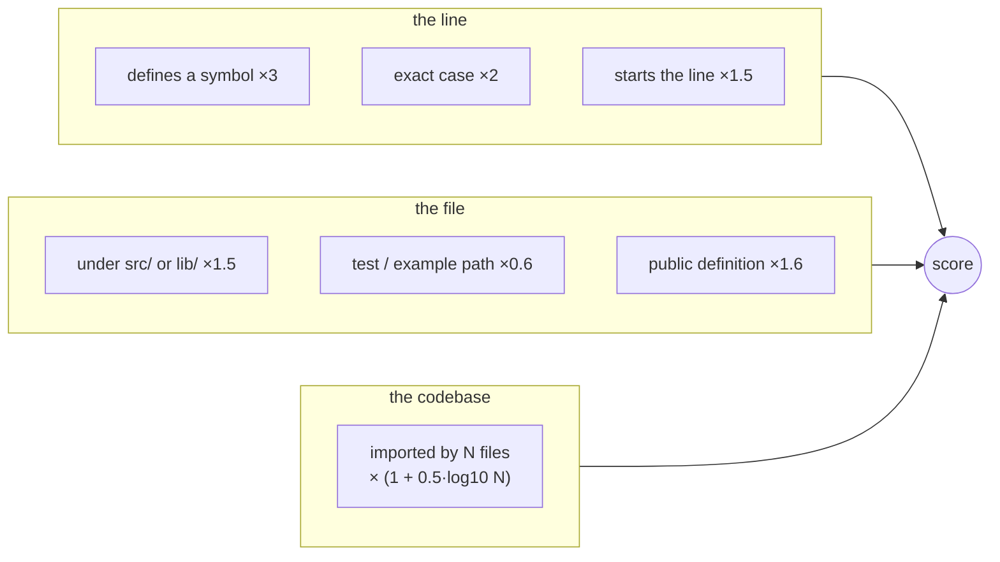

# Ranking

This is the part that makes results feel right. A hit's score combines a
content match with what the index knows about the line, the file and the
codebase. All weights live in one file, `src/search/ranking.rs`.



## Line-level signals

```text
score = base
      × 3.0   if the line defines a symbol
      × 2.0   if the match has the exact case typed
      × 1.5   if the match starts the (trimmed) line
      × 1.5   if the file is under src/ or lib/
      × (1 + 0.5 · log10(files that import this file))
      × max(1 / (1 + ln(1 + length/100)), 0.3)      # long lines damped
```

The dependency factor is the import graph at work: a module that twenty
files import scores 1.65× a module nothing imports, for the same line.
Files that are imported are the ones people are looking for.
The graph has import edges for Rust, Python and JavaScript/TypeScript only
(see [Dependency graph support](../reference/graph-support.md)). In a
repository that mixes those with Go, Java, C#, C/C++ or Ruby, files in the
other languages never get this factor, so a Go module twenty files import
scores like a Rust module nothing imports.

Path signals read the path **under its indexed root**: `src/` and `lib/`
are folders inside the repository, and the folders the repository sits in
(`~/src/…`, `/mnt/tests/…`) never change a score. A test or example path is
a folder whose name starts with `test`, `example`, `mock` or `fixture`, a
`__tests__` or `spec` folder, or a test file name: `test_x.py`,
`x_test.go`, `x_tests.rs`, `x.test.ts`, `x.spec.js`, `tests.rs`. The
factor applies to text, regex and symbol searches alike.

Definitions come from the symbols captured when the file was indexed. If
the file has changed on disk since (file watching off, or not caught up),
a line counts as a definition only while the recorded symbol's name is
still on it, so an edit above a definition drops its boost rather than
moving it onto an unrelated line.

## Result order

Results are in rank order with each file's hits kept together: files in
the order of their best hit, and every hit of a file, by score, before the
next file. No hit waits behind other files' hits; a file with a hundred
matches takes as much of the page as it needs, as in ripgrep. Ties break
on score, then file, then line, so paging is deterministic.

(From v0.12.0 to v0.15.2 results were interleaved by file instead: every
file's best hit, then every file's second, so a file's later hits could be
pages away. That was never asked for and was removed.)

Every result carries `file_hits`, how many hits the search found in its
file across all pages (`file_hits_capped` when the file reached the
per-file cap and may hold more), so a file cut at a page boundary says
"3 of 7 hits" in the web UI rather than "3 hits".

## Reading order

Every search reads its candidate files best first, by a per-file score
that needs no I/O: base, `src/`/`lib/`, code extension,
`log2(symbol count)` (capped), `log2(dependents)` (capped), ×0.7 for test
and example paths, ×5 when the query matches the file's name. It stops
when it has collected enough matches to rank the page (the match budget,
see [Search limits](../benchmarks/search-limits.md)), so for a word with a
million hits page 1 is the best of the best-looking files, not of the
first folders on disk. `rank=auto` and `rank=fast` also stop after
`search.fast_rank_files` files when the server sets one (no limit by
default; a request may ask for more with `max_files`, up to
`search.max_fast_rank_files`); `rank=full` never stops at a file limit.

(Until 0.17, `rank=auto` read files in discovery order up to 5,000
candidates and only the best 2,000 above that, and the budget was 512
matches. On a 372k-file corpus that put 10% of the exhaustive top 50 on
page 1 for common words; the current defaults put 81% there.)

## Symbols and references

Symbol search scores exact name matches above prefix matches above
substrings, with variables and constants slightly below types and
functions of the same name. Reference search returns call sites and type
mentions of an identifier, verified against the current file content, and
ranks them with the same file-level signals. What counts as a reference
differs by language; see [Reference support](../reference/reference-support.md).

## Worked examples

| Query | First result | Why |
|---|---|---|
| `fn main` | `fn main() {` | a definition; start of line |
| `SearchEngine` | `pub struct SearchEngine {` | definition (3×) in `src/` (1.5×) with many importers |
| `impl SearchEngine` | `impl SearchEngine {` | the phrase at the start of the line, in `src/` |
| `fcs refs prune_vanished_in` | the call in `incremental.rs` | the reference table, not text matching |
| `Widget` in a tree with a `widget_test.rs` | the definition, then the importers, then the test | test paths are demoted |

Measured ranking quality (precision@1 over a labelled query set) is part
of the benchmark plan; until it lands, the examples above are covered by
unit tests in `src/search/engine/tests.rs`.
