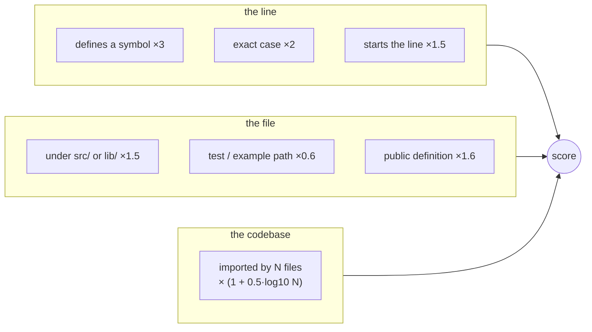

# Ranking

This is the part that makes results feel right. A hit's score combines a
content match with what the index knows about the line, the file and the
codebase. All weights live in one file, `src/search/ranking.rs`.



## Line-level signals

```text
score = base
      × 3.0   if the line defines a symbol
      × 2.0   if the match has the exact case typed
      × 1.5   if the match starts the (trimmed) line
      × 1.5   if the file is under src/ or lib/
      × (1 + 0.5 · log10(files that import this file))
      × max(1 / (1 + ln(1 + length/100)), 0.3)      # long lines damped
```

The dependency factor is the import graph at work: a module that twenty
files import scores 1.65× a module nothing imports, for the same line.
Files that are imported are the ones people are looking for.

## Diversity

Hits are ordered by their rank inside their file: every
file's best hit, then every file's second hit, and so on. One file holding
a hundred matches cannot fill the page. Ties break on score, then file,
then line, so paging is deterministic.

## Fast ranking

Above 5,000 candidates (`rank=auto`) only the top 2,000 files are read
(`fast_rank_files`; a request may ask for more with `max_files`, up to
`max_fast_rank_files`),
chosen by a per-file score that needs no I/O: base, `src/`/`lib/`, code
extension, `log2(symbol count)` (capped), `log2(dependents)` (capped),
×0.7 for test and example paths, ×5 when the query matches the file's
name. `rank=full` reads every candidate.

## Symbols and references

Symbol search scores exact name matches above prefix matches above
substrings, with variables and constants slightly below types and
functions of the same name. Reference search returns call sites and type
mentions of an identifier, verified against the current file content, and
ranks them with the same file-level signals.

## Worked examples

| Query | First result | Why |
|---|---|---|
| `fn main` | `fn main() {` | a definition; start of line |
| `SearchEngine` | `pub struct SearchEngine {` | definition (3×) in `src/` (1.5×) with many importers |
| `impl SearchEngine` | `impl SearchEngine {` | the phrase at the start of the line, in `src/` |
| `fcs refs prune_vanished_in` | the call in `incremental.rs` | the reference table, not text matching |
| `Widget` in a tree with a `widget_test.rs` | the definition, then the importers, then the test | test paths are demoted |

Measured ranking quality (precision@1 over a labelled query set) is part
of the benchmark plan; until it lands, the examples above are covered by
unit tests in `src/search/engine/tests.rs`.
